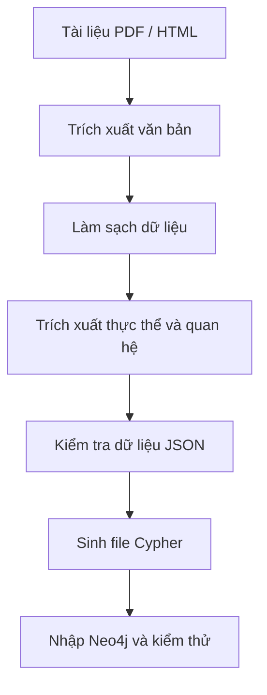
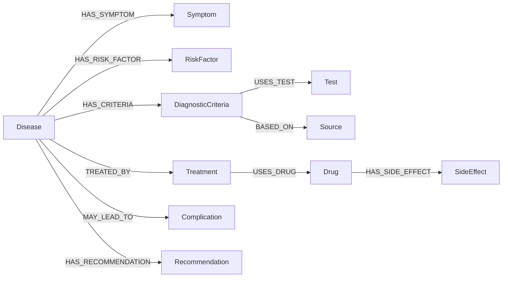

# Prompt xây dựng Knowledge Base về đái tháo đường với Neo4j

## 1. Mục tiêu

Xây dựng cơ sở tri thức (Knowledge Base) dưới dạng Knowledge Graph bằng Neo4j, từ tài liệu PDF và HTML tiếng Việt có sẵn trong dự án. Ưu tiên đái tháo đường típ 2 và tiền đái tháo đường.

Đầu ra chính là file `knowledge_base.cypher` chứa dữ liệu thực tế để nhập vào Neo4j. Chưa tích hợp mô hình Machine Learning, LLM, RAG, Multi-Agent, API hay giao diện.

## 2. Yêu cầu chung

- Sử dụng Python, Neo4j và Cypher.
- Code đơn giản, dễ đọc, dễ hiểu, dễ bảo trì; cấu trúc thư mục rõ ràng.
- Có thể sử dụng thư viện cần thiết, hạn chế framework không cần thiết.
- Không tự tạo kiến thức y khoa không có trong tài liệu.
- Kiến thức phải có nguồn, số trang hoặc mục, năm ban hành và điều kiện áp dụng.
- Kiểm tra cấu trúc dự án hiện tại, tận dụng code và dữ liệu có sẵn, không sửa thành phần không liên quan.

## 3. Cấu trúc thư mục đề xuất

```text
knowledge_base/
├── data/
│   ├── raw/
│   │   ├── pdf/
│   │   └── html/
│   ├── extracted/
│   ├── cleaned/
│   └── structured/
│       ├── entities.json
│       ├── relationships.json
│       └── sources.json
├── scripts/
│   ├── extract_data.py
│   ├── clean_data.py
│   ├── extract_knowledge.py
│   ├── validate_data.py
│   └── generate_cypher.py
├── cypher/
│   ├── constraints.cypher
│   ├── knowledge_base.cypher
│   └── test_queries.cypher
├── docs/
│   ├── schema.md
│   ├── neo4j_guide.md
│   └── report.md
├── requirements.txt
└── README.md
```

## 4. Quy trình thực hiện



### Giai đoạn 1. Khảo sát dữ liệu

- Kiểm tra toàn bộ PDF và HTML trong `data/raw`.
- Phân loại tài liệu: bệnh, triệu chứng, chẩn đoán, thuốc, điều trị, biến chứng, dinh dưỡng, phòng ngừa.
- Kiểm tra trùng lặp; ghi nhận tên, nguồn, năm ban hành, đường dẫn và phiên bản tài liệu.
- Ưu tiên hướng dẫn chuyên môn của Bộ Y tế, kiểm tra văn bản sửa đổi và thay thế.
- Ghi nhận tài liệu lỗi hoặc không thể trích xuất, không âm thầm bỏ qua.
- Cập nhật `docs/report.md` và dừng lại.

### Giai đoạn 2. Trích xuất và làm sạch dữ liệu

Viết `extract_data.py`:

- Đọc PDF bằng PyMuPDF, HTML bằng BeautifulSoup.
- Trích xuất văn bản, giữ số trang PDF hoặc tiêu đề mục HTML.
- Lưu kết quả vào `data/extracted`.
- Đánh dấu trang scan hoặc bảng biểu không trích xuất chính xác để kiểm tra thủ công.

Viết `clean_data.py`:

- Xóa khoảng trắng, ký tự thừa, header/footer lặp lại.
- Chuẩn hóa thuật ngữ nhưng không làm thay đổi ý nghĩa.
- Giữ nguyên chỉ số, đơn vị, dấu so sánh, điều kiện áp dụng và nội dung phủ định.
- Lưu kết quả vào `data/cleaned`.

### Giai đoạn 3. Thiết kế Knowledge Graph

#### Các loại Node

| Node | Ý nghĩa |
|---|---|
| Disease | Bệnh |
| Symptom | Triệu chứng |
| RiskFactor | Yếu tố nguy cơ |
| Cause | Nguyên nhân |
| Test | Xét nghiệm |
| DiagnosticCriteria | Tiêu chuẩn chẩn đoán |
| Drug | Thuốc |
| DrugClass | Nhóm thuốc |
| SideEffect | Tác dụng phụ |
| Contraindication | Chống chỉ định |
| Treatment | Phương pháp điều trị |
| Complication | Biến chứng |
| Food | Thực phẩm |
| Activity | Hoạt động thể chất |
| Recommendation | Khuyến nghị |
| Source | Nguồn tài liệu |

#### Các Relationship

| Relationship | Node bắt đầu | Node kết thúc |
|---|---|---|
| HAS_SYMPTOM | Disease | Symptom |
| HAS_RISK_FACTOR | Disease | RiskFactor |
| HAS_CAUSE | Disease | Cause |
| DIAGNOSED_BY | Disease | Test |
| HAS_CRITERIA | Disease | DiagnosticCriteria |
| USES_TEST | DiagnosticCriteria | Test |
| TREATED_BY | Disease | Treatment |
| USES_DRUG | Treatment | Drug |
| BELONGS_TO | Drug | DrugClass |
| HAS_SIDE_EFFECT | Drug | SideEffect |
| HAS_CONTRAINDICATION | Drug | Contraindication |
| MAY_LEAD_TO | Disease | Complication |
| HAS_RECOMMENDATION | Disease | Recommendation |
| ABOUT_FOOD | Recommendation | Food |
| ABOUT_ACTIVITY | Recommendation | Activity |
| BASED_ON | DiagnosticCriteria | Source |

- Thiết kế thuộc tính phù hợp cho từng Node, mỗi Node có ID duy nhất.
- Mỗi nhận định y khoa và quan hệ phải truy vết được nguồn và vị trí trích xuất; lưu thông tin nguồn trên quan hệ hoặc thiết kế Node bằng chứng nếu cần nhiều nguồn.
- Tiêu chuẩn chẩn đoán phải giữ chỉ số, đơn vị, toán tử so sánh, điều kiện áp dụng và yêu cầu xác nhận nếu có.
- Có thể bổ sung Node và Relationship theo tài liệu thực tế, nhưng phải giải thích lý do.
- Vẽ sơ đồ Mermaid và lưu vào `docs/schema.md`.

Sơ đồ minh họa (không phải dữ liệu đã xác minh):



### Giai đoạn 4. Trích xuất kiến thức

Viết `extract_knowledge.py`:

- Xác định thực thể (Entity) và mối quan hệ (Relationship).
- Chuẩn hóa tên đồng nghĩa, loại bỏ dữ liệu trùng.
- Ghi nhận nguồn của từng kiến thức; đánh dấu nội dung chưa xác minh.
- Có thể dùng từ khóa, Regex hoặc công cụ hỗ trợ. Không bắt buộc sử dụng LLM API.
- Nếu code không thể trích xuất chính xác, tạo dữ liệu có cấu trúc từ nội dung tài liệu và đối chiếu thủ công với nguồn.
- Lưu `entities.json`, `relationships.json`, `sources.json` trong `data/structured`.

### Giai đoạn 5. Kiểm tra dữ liệu

Viết `validate_data.py` để kiểm tra:

- ID và thực thể trùng lặp.
- Thuộc tính bắt buộc bị thiếu.
- Quan hệ tham chiếu đến thực thể không tồn tại.
- Kiến thức thiếu nguồn hoặc vị trí trích xuất.
- Chỉ số y khoa thiếu đơn vị, điều kiện áp dụng.
- Nội dung mâu thuẫn giữa các tài liệu.

Không tự động hợp nhất thông tin y khoa mâu thuẫn. Ghi nội dung cần kiểm tra thủ công vào báo cáo; không đưa kiến thức chưa xác minh vào dữ liệu sử dụng chính thức.

### Giai đoạn 6. Sinh file Cypher

Viết `generate_cypher.py` để đọc JSON và sinh ba file:

**`constraints.cypher`**

- Tạo ràng buộc ID duy nhất và index cần thiết.

**`knowledge_base.cypher`**

- Tạo toàn bộ Node, Relationship, thuộc tính và thông tin nguồn từ dữ liệu thực tế.
- Dùng `MERGE` với ID ổn định để chạy lại không tạo dữ liệu trùng.
- Xử lý ký tự đặc biệt trong chuỗi an toàn.
- Không tự động xóa dữ liệu hiện có trong Neo4j.

**`test_queries.cypher`**

- Thống kê số lượng Node, Relationship và nguồn.
- Truy vấn triệu chứng, yếu tố nguy cơ, tiêu chuẩn chẩn đoán.
- Truy vấn phương pháp điều trị, thuốc, tác dụng phụ và chống chỉ định.
- Truy vấn biến chứng, dinh dưỡng và khuyến nghị.
- Truy xuất nguồn kiến thức, kiểm tra Node và Relationship bất thường.

### Giai đoạn 7. Nhập Neo4j, kiểm thử và viết hướng dẫn

- Kiểm tra toàn bộ quy trình từ tài liệu đến file Cypher.
- Nếu có Neo4j và thông tin kết nối, nhập constraints trước, dữ liệu sau, rồi chạy truy vấn kiểm thử.
- Chạy lại file dữ liệu để kiểm tra khả năng chống trùng.
- Nếu chưa có Neo4j, ghi rõ chưa kiểm thử trên cơ sở dữ liệu thực tế.
- Không hard-code mật khẩu Neo4j trong code.

Viết `README.md`: cài thư viện, chuẩn bị dữ liệu, chạy từng script, sinh Cypher và kiểm tra kết quả.

Viết `docs/neo4j_guide.md`: hướng dẫn cài Neo4j, tạo cơ sở dữ liệu, nhập Cypher, xem đồ thị và chạy truy vấn mẫu.

Viết `docs/report.md`: danh sách tài liệu, số thực thể, quan hệ, nguồn, lỗi, nội dung cần kiểm tra thủ công, kết quả kiểm thử và hướng phát triển.

## 5. Công nghệ sử dụng

| Công nghệ | Vai trò | Bắt buộc |
|---|---|---|
| Python | Xử lý dữ liệu | Có |
| PyMuPDF | Đọc PDF | Có |
| BeautifulSoup | Đọc HTML | Khi có HTML |
| Regex | Nhận dạng mẫu và làm sạch văn bản | Không |
| JSON | Lưu dữ liệu trung gian | Có |
| Neo4j | Cơ sở dữ liệu đồ thị | Có |
| Cypher | Tạo và truy vấn đồ thị | Có |
| Neo4j Python Driver | Kết nối Python với Neo4j | Không |
| LLM API | Hỗ trợ trích xuất kiến thức | Không |

Không cần LangChain, LangGraph, CrewAI hay Spring Boot ở giai đoạn này.

