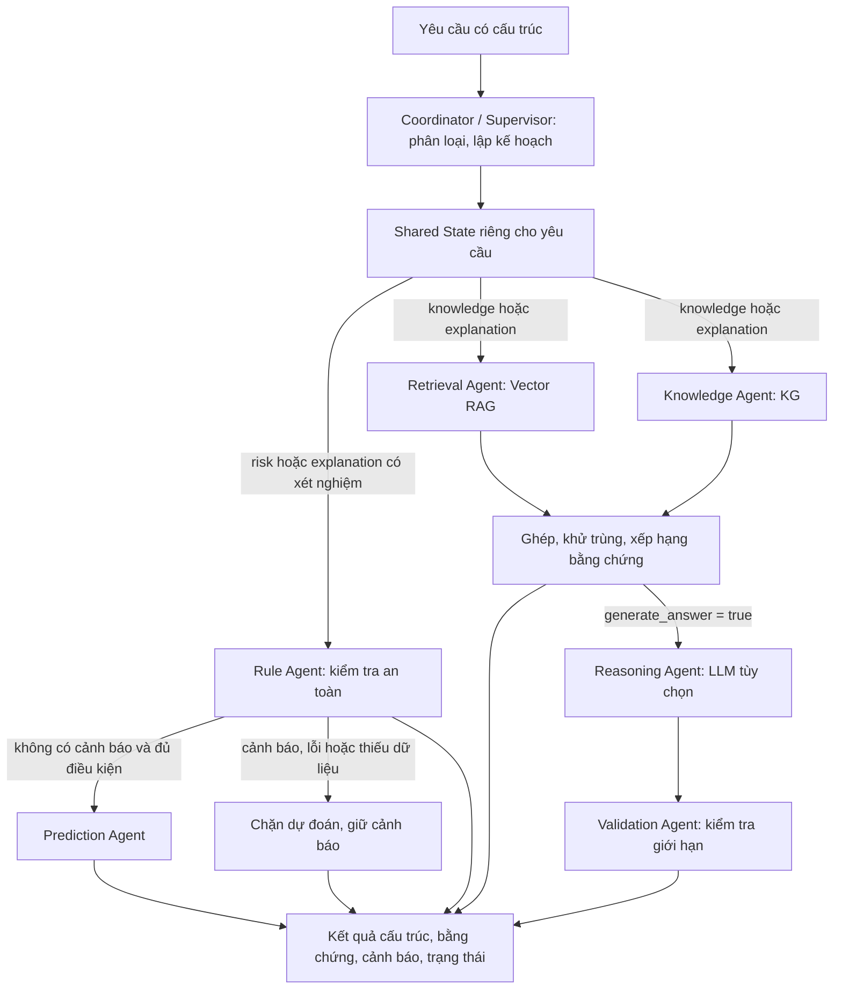

# Giai đoạn 8 — Multi-Agent Supervisor

Ngày thực hiện: 25/11/2026. Mục đích là học tập CNTT; hệ thống không thay thế bác sĩ và chưa được thẩm định lâm sàng.

## Sơ đồ luồng



Sơ đồ có thể chỉnh sửa: [08_multi_agent.drawio](08_multi_agent.drawio). Các nhánh là lựa chọn logic; Agent được chạy tuần tự, không chạy đồng thời.

## Cấu trúc và hoạt động

- `src/agents/coordinator.py`: `CoordinatorAgent` tiếp tục chọn Agent qua `run()` và là điểm gọi `supervise()` cho Supervisor.
- `src/agents/supervisor.py`: `SharedState` riêng theo yêu cầu, phân loại `risk`, `knowledge`, `explanation`, thực thi Agent theo thứ tự, hợp nhất evidence, timeout, giới hạn lượt gọi, log và CLI.
- Bảy Agent đã xây dựng ở giai đoạn 7 được tái sử dụng. `src/agents/workflow.py` và `python -m agents` là luồng giai đoạn trước; Supervisor mới chạy bằng `python -m agents.supervisor`.
- `tests/test_supervisor.py`: kiểm tra phân loại, an toàn, tuyến Agent, timeout, giới hạn lượt gọi, lỗi và log. Sơ đồ chỉnh sửa được lưu cạnh báo cáo.

Không khai báo `intent` thì suy ra từ các trường: có `features`/`measurement` là `risk`; chỉ có `question` là `knowledge`; có cả câu hỏi và dữ liệu là `explanation`. Có thể chỉ định `intent` tường minh; tổ hợp không phù hợp bị từ chối. Không phân loại ngữ nghĩa tự do bằng LLM.

- `risk`: Rule nếu có `measurement`, sau đó Prediction nếu có `features` và bước an toàn đạt; không truy xuất tài liệu.
- `knowledge`: Retrieval và Knowledge; khi `generate_answer=true`, gọi thêm Reasoning và Validation.
- `explanation`: Rule/Prediction theo dữ liệu có sẵn, Retrieval và Knowledge theo câu hỏi; có thể yêu cầu Reasoning và Validation.

Mỗi lượt gọi Agent tốn một đơn vị ngân sách; mặc định tối đa 7 lượt Agent, không tính Coordinator. Timeout mặc định 90 giây cho từng Agent, chạy trong process riêng theo thứ tự; quá thời gian thì kết thúc process. Không tự retry. Nếu hết ngân sách, Agent tương ứng có trạng thái `limit`; nếu LLM/Validation không hoàn thành thì bản trả lời bị từ chối. Timeout chỉ dừng process cục bộ, không bảo đảm hủy yêu cầu đã gửi tới dịch vụ bên ngoài.

## Kiểm tra an toàn và giới hạn

Trước Prediction, bắt buộc có `measurement` glucose để Rule Agent chạy; HbA1c một mình không đủ cho cổng này (`blocked_missing_glucose`). Nếu Rule lỗi, timeout, kết quả không hợp lệ, có cảnh báo, hoặc có `issues` ngoài `interpretation_not_supported`, Prediction bị chặn. Với glucose đo cá nhân, `interpretation_not_supported` có thể xuất hiện vì Rule không diễn giải chẩn đoán mẫu đó; nếu không có lỗi/cảnh báo khác, trạng thái là `passed_limited`. Đây chỉ là cổng kỹ thuật dựa trên các quy tắc đã có, **không xác nhận người dùng an toàn để đánh giá** và không bao quát triệu chứng khẩn cấp hoặc mọi điều kiện lâm sàng. Trường hợp thiếu xét nghiệm trả `blocked_missing_measurement`, không mặc định là an toàn.

Kết quả Rule và `alerts` vẫn trả ra khi Prediction bị chặn hoặc Agent khác lỗi. Kết quả của từng Agent, bằng chứng và trạng thái được lưu trong Shared State chỉ trong bộ nhớ của lần gọi; phần dữ liệu cần thiết được trả về cho người gọi. Validation chỉ kiểm tra hình thức citation/nguồn, một số mẫu câu rủi ro, cảnh báo bị bỏ/sửa và một trường hợp khác biệt ML–xét nghiệm; không chứng minh từng nhận định thực sự được nguồn hỗ trợ hay an toàn. Không có LLM được cấu hình thì `draft_status=llm_not_configured` và trả thông báo không đủ bằng chứng; `valid=true` khi đó chỉ nói bản từ chối qua kiểm tra hình thức.

Logger `diabetes.supervisor` ghi tên Agent và trạng thái cố định tới stderr, không ghi câu hỏi, feature, chỉ số, kết quả, exception message hay khóa. Không ghi file log. Đầu ra JSON vẫn chứa dữ liệu/kết quả sức khỏe và phải được bên gọi bảo vệ; không chuyển toàn bộ stdout vào log. Nếu bật `generate_answer`, câu hỏi, evidence và kết quả ML/rule có thể được gửi tới endpoint LLM đã cấu hình; chỉ dùng dịch vụ được phép xử lý dữ liệu đó.

## Cách chạy

Trong môi trường `start_ml`, từ thư mục gốc:

```powershell
$env:PYTHONPATH='src'
$env:PYTHONIOENCODING='utf-8'
'{"intent":"risk","measurement":{"test_type":"glucose_meter","value":53,"unit":"mg/dL"}}' | python -m agents.supervisor
python -m pytest tests/test_supervisor.py tests/test_agents.py tests/test_agent_workflow.py -q
```

Giá trị ví dụ chỉ dùng kiểm thử. Luồng knowledge cần `question`; explanation cần cả `question` và `features` hoặc `measurement`. Prediction yêu cầu tám trường Pima như `07_agents.md`. Neo4j, index và embedding cần được chuẩn bị như `05_rag.md`; LLM tùy chọn cấu hình `RAG_LLM_ENDPOINT`, `RAG_LLM_MODEL` và `RAG_LLM_API_KEY`. Từ Python dùng `CoordinatorAgent().supervise(request)`; do sử dụng multiprocessing `spawn`, gọi từ chương trình có `if __name__ == '__main__':` trên Windows. Không chạy subprocess spawn từ môi trường không hỗ trợ import module chính.

## Kiểm thử

- `test_supervisor.py`, `test_agents.py`, `test_agent_workflow.py`, `test_rule_engine.py`, `test_rag.py`: **64/64 đạt**, có một cảnh báo deprecation từ plugin anyio.
- Kiểm thử timeout bằng Agent cố ý ngủ, giới hạn số lượt gọi, lỗi Agent, log không chứa chuỗi sức khỏe thử nghiệm, chặn Prediction khi thiếu hoặc có cảnh báo: đạt.
- Luồng risk chạy thật với Rule Engine và pipeline ML đã lưu; Rule chạy trước Prediction và cả hai hoàn thành. Đây là dữ liệu kiểm thử, không phải đánh giá bệnh nhân.
- Luồng explanation chạy thật với Rule, Retrieval và Knowledge trên Neo4j cục bộ; Reasoning trả `llm_not_configured` do không có endpoint. Chưa kiểm thử LLM thực hoặc đánh giá độ đúng y khoa của câu trả lời.
- Sơ đồ `.drawio` đã kiểm tra XML hợp lệ và ID không trùng; không kiểm thử hiển thị trong draw.io Desktop tại môi trường này.

Sau đó đã cấu hình Gemini và kiểm thử thực tế; kết quả HTTP 503/timeout và các giới hạn được ghi trong [09_kiem_thu_gemini.md](09_kiem_thu_gemini.md).
