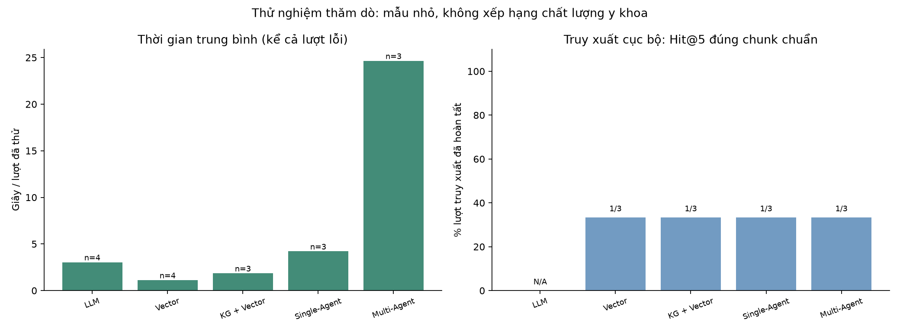

# Giai đoạn 10 — Kiểm thử và thực nghiệm so sánh

Ngày chạy: 25/11/2026. Đây là thử nghiệm CNTT thăm dò, không phải đánh giá lâm sàng. **Chưa thể kết luận phương pháp nào trả lời chính xác hơn:** Gemini trả HTTP 429/503, không có câu trả lời hợp lệ, và đợt gọi LLM phải dừng trước khi hoàn tất bộ kế hoạch.

## Phạm vi, dữ liệu và cách làm

Bộ [questions.json](../../data/evaluation/questions.json) có ba câu trắc nghiệm được biên soạn từ ba bài của cùng một hệ thống bệnh viện; mỗi câu có đáp án, ID chunk, ID nguồn, URL và đoạn trích nguyên văn trong dữ liệu dự án. Script kiểm tra đoạn trích thực sự có trong chunk và nguồn khớp. Đây là đáp án chuẩn theo tài liệu cho mục đích thử nghiệm, **chưa được chuyên gia y khoa thẩm định**; chỉ có một chunk chuẩn cho mỗi câu và không thể đại diện cho toàn bộ kiến thức y tế.

| Mã | Chủ đề câu hỏi | Đáp án chuẩn | Bằng chứng gốc |
| --- | --- | --- | --- |
| q01 | Khoảng thời gian HbA1c phản ánh | B: 2–3 tháng | [Đái tháo đường: nguyên nhân, chẩn đoán, điều trị](https://tamanhhospital.vn/benh/dai-thao-duong/) |
| q02 | Thời gian nhịn ăn trước FPG | C: ít nhất 8 giờ | [Chỉ số tiểu đường bao nhiêu thì nguy hiểm?](https://tamanhhospital.vn/chi-so-tieu-duong-bao-nhieu-thi-nguy-hiem/) |
| q03 | Nhóm dấu hiệu được tài liệu nêu | A: khát nước nhiều, tiểu nhiều, nhanh đói | [10 dấu hiệu tiểu đường thường gặp](https://tamanhhospital.vn/dau-hieu-tieu-duong/) |

Kế hoạch là cùng ba câu, cùng Gemini `gemini-4-hydrogen`, `temperature=0`, hai lần mỗi phương pháp: 30 lượt. Hai lần cho phép đo tỷ lệ câu có cùng lựa chọn khi **cả hai lần đều trả đáp án phân tích được**. Các phương pháp có retrieval được yêu cầu dẫn `[S#]`; LLM thuần không có corpus để dẫn. Prompt của Single/Multi dùng Reasoning Agent hiện có nên không hoàn toàn giống prompt của ba baseline; do đó ngay cả khi có kết quả cũng cần kiểm soát prompt kỹ hơn trước khi rút ra kết luận nhân quả.

Phương pháp 4 là một bộ điều khiển tuần tự thử nghiệm gọi trực tiếp pipeline ML, Rule Engine và retrieval, không có cổng an toàn Supervisor trước ML. Phương pháp 5 dùng Supervisor hiện có. Một dòng Pima sẵn có được dùng cục bộ để thực thi ML; harness giả định glucose là số đo OGTT 2 giờ theo [mô tả bộ Pima](https://search.r-project.org/CRAN/refmans/faraway/html/pima.html), nhưng chưa xác minh độc lập nguồn gốc của file CSV và CSV không có trạng thái mang thai hay lượng glucose nạp. Những trường thiếu không được tự điền. Supervisor vì thế chặn Prediction ở phương pháp 5; phương pháp này **chưa thực thi đủ nhánh ML** trong thử nghiệm này. Các nhãn, dự đoán hay kết quả rule suy ra được phép gửi Gemini theo xác nhận của người dùng; không gửi tên hay thông tin liên hệ. Không dùng dòng này để ước tính accuracy ML, vì nó có thể thuộc tập train của mô hình.

## Kết quả thực tế

Đợt LLM ghi được **17/30 lượt đã hoàn tất**, trong đó có 8 HTTP 503, 6 HTTP 429 và 3 lỗi Reasoning Agent không lộ chi tiết lỗi. Không có lượt nào trả lựa chọn A/B/C được phân tích. Sau khi 429 tiếp diễn dù đã nghỉ 60 giây, đợt gọi được dừng; một lượt đang truy xuất bị ngắt giữa chừng không được ghi là thành công. Lượt tiếp tục chỉ nối thêm tổ hợp chưa hoàn tất, không sửa các dòng đã ghi. q01 có 10 lượt, q02 có 7, q03 chưa được chạy với LLM; do đó chưa có so sánh hoàn chỉnh trên cùng bộ câu hỏi.

| Phương pháp | Lượt LLM đã ghi / dự kiến | Trạng thái đã ghi | Accuracy trên đáp án hợp lệ | Nhất quán hai lần | Token / chi phí thực |
| --- | ---: | --- | --- | --- | --- |
| 1. LLM thuần | 4/6 | 3 × 503, 1 × 429 | N/A — 0 câu hợp lệ | N/A — 0 cặp hợp lệ | N/A |
| 2. LLM + Vector RAG | 4/6 | 2 × 503, 2 × 429 | N/A — 0 câu hợp lệ | N/A — 0 cặp hợp lệ | N/A |
| 3. LLM + KG + Vector RAG | 3/6 | 1 × 503, 2 × 429 | N/A — 0 câu hợp lệ | N/A — 0 cặp hợp lệ | N/A |
| 4. Single-Agent + ML + Rules + KG + RAG | 3/6 | 2 × 503, 1 × 429 | N/A — 0 câu hợp lệ | N/A — 0 cặp hợp lệ | N/A |
| 5. Multi-Agent + ML + Rules + KG + RAG | 3/6 | 3 × lỗi Reasoning, không có mã HTTP | N/A — 0 câu hợp lệ | N/A — 0 cặp hợp lệ | N/A |

N/A không phải bằng 0: lỗi API không được tính là câu trả lời sai, và không có metadata usage/token để suy ra tiền đã dùng. Supervisor cố ý che chi tiết exception nên không kết luận ba lỗi Reasoning là mã HTTP nào.

### Khả năng truy xuất cục bộ trên đủ ba câu

Vì không thể hoàn tất LLM, đã chạy riêng 12 lượt retrieval cục bộ **không gọi LLM**, một lượt cho mỗi câu và mỗi luồng có truy xuất. Kết quả dưới đây là **Hit@5 theo đúng ID chunk cha được chọn làm chuẩn**, không phải accuracy câu trả lời, không kiểm tra rằng đoạn con được chọn thật sự chứa câu trả lời, và không tính những chunk khác có cùng bằng chứng.

| Phương pháp | Hit@5 chunk chuẩn | ML trong lượt cục bộ | Ghi chú |
| --- | ---: | --- | --- |
| LLM thuần | Không áp dụng | Không | Không có retrieval |
| Vector RAG | 1/3 | Không | Không dùng KG |
| KG + Vector RAG | 1/3 | Không | Kết hợp theo RRF |
| Single-Agent + KG + RAG | 1/3 | 3/3 lượt | Gọi ML cục bộ trước Rule; chưa gọi LLM thành công |
| Multi-Agent + KG + RAG | 1/3 | 0/3 lượt | Supervisor chặn Prediction do thiếu điều kiện xét nghiệm |

Ví dụ q02 không lấy đúng chunk chuẩn đã chọn, nhưng cả bốn luồng đều trả `chunk_4f3d427afd6d1f34f1b494dd`, một chunk khác có nêu yêu cầu nhịn ăn ít nhất 8 giờ. Vì vậy **1/3 không phải recall tất cả bằng chứng đúng**. Cần nhiều chunk chuẩn cho từng câu và đánh giá nội dung đoạn con trước khi so sánh retrieval. KG hiện chủ yếu cung cấp `MENTIONS`, không có assertion y khoa đã duyệt; KG demo chưa được đưa vào luồng assertion đã duyệt.

### Thời gian, bộ nhớ và chi phí

Các giá trị thời gian và RAM bên dưới là trung bình **những lượt LLM đã thử nhưng đều thất bại**, không phải độ trễ câu trả lời thành công. RAM là đỉnh tổng RSS process benchmark và các process con, lấy mẫu khoảng 50 ms; có thể đếm trùng trang nhớ dùng chung, không bao gồm Neo4j hoặc dịch vụ Gemini. Embedding đã được nạp vào process benchmark trước mọi phương pháp, kể cả LLM thuần; Multi-Agent còn tải embedding trong process con. Vì vậy các giá trị này **không phải RAM độc lập công bằng của từng kiến trúc**.

| Phương pháp | Số lượt | Thời gian lỗi trung bình (giây) | RSS đỉnh trung bình (MiB) |
| --- | ---: | ---: | ---: |
| LLM thuần | 4 | 3,05 | 1.199,9 |
| Vector RAG | 4 | 1,12 | 1.203,5 |
| KG + Vector RAG | 3 | 1,86 | 1.204,2 |
| Single-Agent | 3 | 4,21 | 1.205,5 |
| Multi-Agent | 3 | 24,65 | 2.439,6 |



Biểu đồ trái gồm các lượt lỗi và cỡ mẫu khác nhau; biểu đồ phải là phép đo retrieval cục bộ riêng, không gọi LLM. Không dùng chúng để xếp hạng chất lượng phương pháp.

Không có usage trả về từ các lượt gọi thất bại, và không có dữ liệu hóa đơn hoặc tier tài khoản. Vì vậy **không thể xác định token hoặc chi phí thực**, kể cả chi phí có thể phát sinh từ một request bị ngắt. Để tham chiếu, [bảng giá Google](https://ai.google.dev/gemini-api/docs/pricing) tại ngày kiểm thử niêm yết Gemini 4 Hydrogen paid standard $1,50/triệu token đầu vào và $7,50/triệu token đầu ra gồm thinking; free tier, cache và các điều kiện khác có thể thay đổi chi phí. Không áp giá này thành hóa đơn thực khi không có usage và tier.

## Kiểm thử chức năng và dữ liệu bất thường

- Toàn bộ suite Python: **89/89 đạt**; component frontend: **3/3 đạt**. Có một cảnh báo deprecation từ plugin anyio. Đây là unit/integration test, không chứng minh hệ thống đúng lâm sàng.
- Dữ liệu thiếu: Rule Engine và Supervisor kiểm tra thiếu trường/điều kiện, đồng thời giữ cảnh báo glucose thấp; trong thử nghiệm Pima thiếu `pregnant` và `glucose_load_g`, Prediction của Supervisor bị chặn.
- Dữ liệu sai: unit test bao phủ sai đơn vị, kiểu dữ liệu, số âm/0/NaN và điều kiện xét nghiệm không áp dụng. Các giá trị biên trong test là fixture kỹ thuật, không phải hồ sơ bệnh nhân hay kết quả thực nghiệm.
- Mâu thuẫn: test mô phỏng nhãn ML 0 cùng rule FPG đạt ngưỡng; Validation phát cảnh báo khác biệt, không tự chẩn đoán. Đây chỉ là một mẫu kiểm tra có chủ đích, không chứng minh phát hiện được mọi mâu thuẫn.
- Lỗi, timeout, giới hạn lượt gọi và log không lộ chuỗi dữ liệu thử nghiệm được kiểm tra bằng mock và tiến trình chậm. Chưa kiểm thử lại trực quan toàn bộ React trên desktop/mobile trong lượt này; LLM thật không hoàn thành đầu-cuối.

## Ưu, nhược điểm và hướng tiếp theo

| Cách tiếp cận | Ưu điểm thiết kế | Nhược điểm/giới hạn quan sát |
| --- | --- | --- |
| LLM thuần | Ít thành phần, không cần index | Không có nguồn riêng trong ngữ cảnh; các lượt thử đều lỗi API |
| Vector RAG | Có thể truy xuất tài liệu và nguồn | Chunk chuẩn chỉ được hit 1/3 trong mẫu nhỏ; có thể bỏ sót bằng chứng ở các đoạn khác |
| KG + RAG | Thêm tín hiệu thực thể và quan hệ `MENTIONS` | Không chứng minh quan hệ lâm sàng; trong mẫu này hit chuẩn vẫn 1/3 |
| Single-Agent | Một luồng tuần tự dễ quan sát, có chạy ML/rule cục bộ | Baseline thử nghiệm không có cổng an toàn trước ML; chưa trả lời LLM thành công |
| Multi-Agent | Có phân vai, cổng an toàn, timeout và validation | Prediction bị chặn với dữ liệu thiếu; process/embedding tạo overhead; chưa có câu trả lời LLM hợp lệ |

Tiếp theo cần khôi phục hạn mức/khả dụng Gemini, chạy đủ các tổ hợp thiếu và ghi cả lỗi; mở rộng bộ câu hỏi có nhiều nguồn chuẩn, được chuyên gia duyệt, bao gồm thiếu/mâu thuẫn/ngoài phạm vi; phân biệt đánh giá đúng chunk với đúng nội dung và chất lượng citation; kiểm tra nhiều lần, báo khoảng tin cậy. Cần thiết kế lại bài toán test ML/rule với dữ liệu có đủ điều kiện áp dụng, không suy đoán thông tin thiếu. Đo RAM bằng các process cô lập, tính cả Neo4j và tải model, đồng nhất cơ chế warm/cold; chỉ tính chi phí từ usage và bảng giá/tier tương ứng. Cần đánh giá bảo mật, giao diện và thẩm định lâm sàng trước mọi ứng dụng thực tế.

## Dữ liệu và cách chạy lại

- Kết quả thô từng lượt LLM đã hoàn tất: [evaluation_20261125_run01.jsonl](../../reports/evaluation_20261125_run01.jsonl).
- Kết quả retrieval cục bộ: [evaluation_local_20261125_run01.jsonl](../../reports/evaluation_local_20261125_run01.jsonl).
- Tổng hợp máy đọc được: [evaluation_20261125_summary.json](../../reports/evaluation_20261125_summary.json). Mã: `src/evaluation/benchmark.py`, `local_retrieval.py`, `report.py`; kiểm thử: `tests/test_evaluation.py`.
- `benchmark --resume` chỉ thêm các tổ hợp còn thiếu, dừng sau hai lần HTTP 429 trong một lần chạy lại và nghỉ 60 giây sau lần 429 đầu; nó không ghi đè các kết quả cũ. Việc chạy lại sẽ gọi Gemini, có thể mất phí và gửi câu hỏi, KB cùng kết quả ML/rule suy ra theo cấu hình/đồng ý đã nêu.

```powershell
$env:PYTHONPATH='src'
$env:HF_HUB_OFFLINE='1'
python -m evaluation.benchmark --repeats 2 --out reports/evaluation_20261125_run01.jsonl --resume
python -m pytest tests -q
```

Phải xuất tổng hợp và biểu đồ sang **tên file mới** sau một lần chạy tiếp; các file hiện tại thể hiện đúng trạng thái 17 lượt đã ghi ở thời điểm báo cáo.
